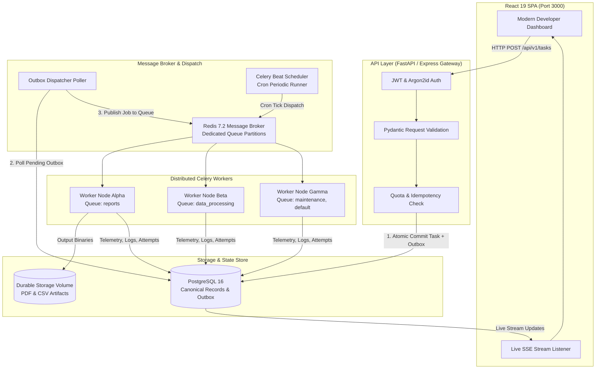

# AsyncFlow — Distributed Task Scheduling & Background Processing Platform

[](https://github.com/asyncflow/asyncflow/actions)
[](https://opensource.org/licenses/MIT)
[](https://www.python.org/downloads/)
[](https://react.dev/)
[](https://docs.docker.com/compose/)

AsyncFlow is a production-grade, distributed task scheduling and background processing platform built to execute, monitor, and manage long-running background jobs without blocking HTTP request threads.

 


## 1. System Architecture

AsyncFlow uses an asynchronous pipeline centered on a **Transactional Outbox pattern** to guarantee resilient task ingestion, zero loss during broker reboots, and cooperative worker cancellation.



---

## 2. Key Features

- **Non-Blocking Architecture:** Ingestion endpoints acknowledge immediately with canonical public task IDs. Heavy workloads never run in HTTP handlers.
- **Transactional Outbox Engine:** Prevents stranded database records if broker dispatches fail. Tasks are saved as `pending_dispatch` and guaranteed to publish to Redis.
- **Dedicated Queue Partitions:**
  - `reports`: Heavy vector PDF layout rendering and CSV streaming exports.
  - `data_processing`: Mathematical batch transforms, quantile rollups, and anomaly detection.
  - `maintenance`: Database index cleanup, expired artifact purging.
  - `default`: Schema validation, heartbeat monitors, and custom background tasks.
- **Cooperative Cancellation:** Workers check cancellation signals at defined execution checkpoints and abort cleanly without leaving orphaned locks.
- **Exponential Backoff & Jitter:** Configurable retry policies with bounded exponential backoff and attempt preservation.
- **Real-Time Observability:** Server-Sent Events (SSE) stream progress from 0% to 100%, updating timeline milestones and worker logs live.
- **Enterprise RBAC:**
  - **Admin:** Global cluster operations, user management, and manual outbox recovery.
  - **Operator:** Schedule orchestration, retry/cancel privileges across all jobs.
  - **User:** Tenant isolation, private task history, and artifact downloads.
- **Prometheus Export:** `/api/v1/metrics/prometheus` endpoint exposing task throughput, queue depths, and worker counts.

---

## 3. Technology Stack

| Layer | Technologies |
|---|---|
| **Frontend** | React 19, TypeScript, Vite, Tailwind CSS, Lucide React, Recharts, TanStack Query |
| **Backend & API** | Python 3.12, FastAPI, Uvicorn, Pydantic 2, SQLAlchemy 2.x, Alembic, Express TS |
| **Broker & Queue** | Redis 7.2, Celery 5.3, Celery Beat |
| **Database** | PostgreSQL 16 (JSONB payloads, typed foreign keys, time-series events) |
| **Security** | Argon2id password hashing, JWT Bearer tokens, HTTP-only cookie rotation, CORS |
| **Infrastructure** | Docker, Docker Compose, GitHub Actions CI/CD |

---

## 4. Quick Start with Docker Compose

Launch the entire stack (PostgreSQL, Redis, FastAPI, Celery Workers, Beat Scheduler, and Frontend) in seconds:

```bash
# 1. Clone repository
git clone https://github.com/asyncflow/asyncflow.git
cd asyncflow

# 2. Configure environment
cp .env.example .env

# 3. Launch all cluster services
docker compose up -d --build

# 4. Verify running services
docker compose ps
```

Access the user interface at: **http://localhost:3000**  
API Documentation at: **http://localhost:8000/docs**

---

## 5. Local Development Setup

### A. Frontend (Node.js & Express Full-Stack)
```bash
npm install
npm run dev
```
The unified full-stack server starts on `http://localhost:3000` with Vite middleware mounted.

### B. Python FastAPI & Celery Worker
```bash
cd backend
python -m venv .venv
source .venv/bin/activate
pip install -r requirements.txt

# Start FastAPI API
uvicorn app.main:app --port 8000 --reload

# In separate terminals:
# Start Celery Worker
celery -A app.tasks.celery_app worker --loglevel=INFO -Q reports,data_processing,maintenance,default

# Start Celery Beat Scheduler
celery -A app.tasks.celery_app beat --loglevel=INFO
```

---

## 6. Seeded Demo Accounts

| Role | Email | Password | Scope |
|---|---|---|---|
| **Admin** | `admin@asyncflow.io` | `admin123` | Full access, user admin, outbox recovery |
| **Operator** | `operator@asyncflow.io` | `operator123` | Cluster schedules, cancel/retry any job |
| **User** | `user@asyncflow.io` | `user123` | Personal jobs, private artifact downloads |

*(Use the active persona switcher in the sidebar to test role transitions instantly.)*

---

## 7. REST API Contract (`/api/v1`)

### Authentication
- `POST /api/v1/auth/register` — User registration
- `POST /api/v1/auth/login` — Authentication returning Bearer token
- `POST /api/v1/auth/refresh` — Session refresh
- `GET  /api/v1/auth/me` — Authenticated profile

### Distributed Tasks
- `POST /api/v1/tasks` — Enqueue task (supports `Idempotency-Key` header)
- `GET  /api/v1/tasks` — Filtered & paginated list (`status`, `taskType`, `priority`, `search`)
- `GET  /api/v1/tasks/{task_id}` — Detailed execution record
- `POST /api/v1/tasks/{task_id}/retry` — Trigger manual retry generation
- `POST /api/v1/tasks/{task_id}/cancel` — Request cooperative cancellation
- `GET  /api/v1/tasks/{task_id}/logs` — Filterable structured logs
- `GET  /api/v1/tasks/{task_id}/download` — Stream generated PDF or CSV output
- `GET  /api/v1/tasks/stream` — Real-time Server-Sent Events (SSE)

### Scheduling & Monitoring
- `POST /api/v1/schedules` — Register recurring cron schedule
- `GET  /api/v1/schedules` — Active schedules
- `POST /api/v1/schedules/{id}/trigger` — On-demand schedule execution
- `GET  /api/v1/metrics/overview` — Cluster summary statistics
- `GET  /api/v1/workers` — Worker heartbeats, concurrency, and queues
- `GET  /api/v1/metrics/prometheus` — Prometheus scrape target
- `POST /api/v1/outbox/recover` — Trigger transactional outbox recovery cycle

---

## 8. Automated Testing

Run the test suite across frontend and backend:

```bash
# Frontend TypeScript validation
npm run lint

# Backend Pytest suite
PYTHONPATH=backend pytest backend/tests -v
```

---

## 9. Security Principles

1. **No Code Execution:** The system forbids dynamic Python `eval()` or shell-command payloads from untrusted inputs. All task types are statically typed and whitelisted.
2. **Tenant Isolation:** Ordinary users cannot view or download artifacts belonging to other accounts.
3. **Log Sanitization:** Sensitive authorization tokens and raw secrets are redacted from logs and audit records.
4. **Idempotent Dispatch:** Re-submitting requests with the same `Idempotency-Key` returns the original task without duplicating queue workloads.
